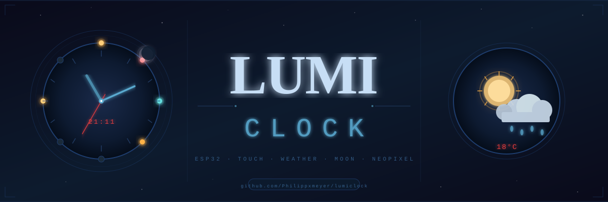

# Lumiclock

> Eine Kinderuhr auf ESP32-Basis mit Wetter, Mondphase, Touch-Bedienung, Nachtlicht und OTA-Updates – also genau das, was man baut, wenn ein normaler Wecker einfach **zu wenig Overengineering** hat.

## Was ist das?

**Lumiclock** ist ein Arduino/ESP32-Projekt für ein 3.5" TFT-Display (480×320), das fünf Ansichten bietet:

1. **Uhrzeit + Datum**
2. **Wetter** (über Open-Meteo, ohne API-Key)
3. **Mondphase** (lokal berechnet)
4. **Tagesviertel-Vorhersage** (die nächsten drei Sechsstundenblöcke)
5. **Drei-Tage-Wetterprognose** (bis 14 Uhr heute/+1/+2, ab 14 Uhr +1/+2/+3)

Gesteuert wird das Ganze über **kapazitive Touch-Pads** (T6/T7/T8). Zusätzlich gibt’s einen **NeoPixel-Ring** als Nachtlicht und **OTA-Updates**, damit du Firmware nicht jedes Mal per Kabel einspielen musst wie im Mittelalter von 2014.

---

## Features (aka „Warum das Teil cool ist“)

- **Große, gut lesbare Uhrzeitanzeige** mit Datum auf Deutsch.
- **Aktuelle Wetterdaten mit Abruf alle 30 Minuten** (Temperatur, gefühlte Temperatur, Wetterzustand + Icon).
- **Tagesviertel- und Drei-Tage-Prognose** mit Wetter-Icon, Höchst-/Tiefsttemperatur und Niederschlagswahrscheinlichkeit im gleichen Drei-Spalten-Layout.
- **Mondphasenanzeige** inkl. Namen und Mondalter.
- **Touch-UI mit Entprellung und Fehltrigger-Schutz**.
- **Nachtmodus** (Display-Hintergrundlicht aus, sanftes Ringlicht an).
- **Automatischer Rücksprung zur Uhranzeige** nach Timeout.
- **OTA-Firmwareupdates** über WLAN.
- **LittleFS-Assets** (PNG-Icons für Wetter und Mondphasen).

---

## Hardware-Annahmen

Das Projekt geht (laut Code) von folgender Verdrahtung aus:

- **ESP32**
- **TFT 480×320** mit `TFT_eSPI`
- **TFT Backlight Pin**: GPIO **4**
- **NeoPixel Ring (WS2812)**:
  - Data Pin: GPIO **12**
  - LEDs: **8**
- **Touch-Eingänge**:
  - Uhr: **T6**
  - Wetter / Prognose: **T7**
  - Mond: **T8**

Die Touch-Pins stehen in `touch_control.h`, die Ring-Konfiguration in `ring_light.h` und der Backlight-Pin als `TFT_LED` in `lumiclock.ino`. Displaytreiber und Display-Pins werden in der verwendeten `TFT_eSPI`-Konfiguration festgelegt.

---

## Software-Architektur

Das Projekt ist modular in Header-Dateien aufgeteilt:

- `lumiclock.ino` – Setup/Loop, Display-Rendering-Flow, Nachtmodus, PNG-Decoder-Callbacks
- `lumiclock_state.h` – State Machine (`STATE_CLOCK`, `STATE_WEATHER`, `STATE_MOON`, `STATE_QUARTER_FORECAST`, `STATE_FORECAST`)
- `touch_control.h` – Touch-Interrupts, Debounce, Backlight-Wakeup-Logik
- `display_time.h` – Uhrzeit/Datum rendern
- `weather.h` – Wetter- und Prognoseabruf via HTTPS und Rendering
- `forecast_data.h` – JSON-Auswertung, Tages-/Viertelcache und zeitabhängige Auswahl
- `moon_phase.h` – Näherungsberechnung der Mondphase aus dem Datum + Rendering
- `ring_light.h` – NeoPixel-Ringsteuerung/Nachtlicht
- `ntp_client.h` – NTP + Zeitzonenhandling (inkl. Sommerzeit)
- `ota_update.h` – ArduinoOTA Integration
- `wifi_credentials.h` – lokale WLAN-Zugangsdaten und `connectToWiFi()`; durch `.gitignore` ausgeschlossen
- `Baloo2_*.h` – eingebettete Schriftarten
- `build_opt.h` / `lumiclock_build.h` – projektweite Auswahl der tatsächlich genutzten TFT-Schriften
- `data/` – PNG-Dateien für das LittleFS-Dateisystem

`lumiclock.ino` verbindet die Module. Die Header enthalten neben Deklarationen auch Funktionsdefinitionen und globale Variablen; gemeinsame Objekte wie `tft` werden über `extern` genutzt. Die Einbindereihenfolge ist daher teilweise wichtig.

`loop()` verarbeitet OTA, Touch-Ereignisse, Zustandswechsel, Anzeige, Wetterabrufe und Nachtmodus nacheinander. `stateRendered` verhindert unnötiges Neuzeichnen; die Uhr wird zusätzlich beim Minutenwechsel aktualisiert. Netzwerkabrufe blockieren diesen Ablauf zeitweise.

---

## Zustände & Bedienung

### Zustände

- `STATE_CLOCK`: Standardansicht
- `STATE_WEATHER`: Wetteransicht
- `STATE_MOON`: Mondansicht
- `STATE_QUARTER_FORECAST`: nächste drei Tagesviertel
- `STATE_FORECAST`: Drei-Tage-Prognose

Nicht-Uhrzustände springen nach `STATE_TIMEOUT_MS` (10 Sekunden ab dem Zustandswechsel) automatisch zurück auf die Uhr. Eine erneute Auswahl desselben Zustands setzt diesen Timer nicht zurück.

### Touch-Verhalten

| Touch-Pad | Aktion |
|---|---|
| T6 | Uhr anzeigen; Ringlicht vorübergehend auf Warmweiß mit Helligkeit 20 setzen |
| T7 | Aktuelles Wetter → nächste drei Tagesviertel → Drei-Tage-Prognose → aktuelles Wetter; aus Uhr/Mond beginnt die Folge mit aktuellem Wetter |
| T8 | Mondphase anzeigen |

- Der Touch-Interrupt setzt nur ein Flag; die eigentliche Verarbeitung erfolgt in `loop()`.
- Die Auslöseschwellen werden beim Start auf 50 % des jeweiligen Leerlaufwerts gesetzt.
- Danach wird die Berührung doppelt geprüft (`touchRead()` zweimal mit 8 ms Abstand), um Fehlauslösungen zu reduzieren.
- Zusätzliche Schutzmechanismen: 2 Sekunden Boot-Guard (`TOUCH_BOOT_GUARD_MS`) und 350 ms Entprellzeit (`TOUCH_DEBOUNCE_MS`).
- Jede akzeptierte Berührung aktiviert die Displaybeleuchtung für 10 Sekunden (`BACKLIGHT_TIMEOUT_MS`). Dieser Timer wird bei jeder akzeptierten Berührung neu gestartet und ist unabhängig vom Ansichts-Timeout.

Ja, kapazitiver Touch kann zickig sein. Nein, du bist damit nicht allein.

---

## Wetterdaten

- Quelle: **Open-Meteo**
- Abruf: **beim Start, danach alle 30 Minuten**; aktuelles Wetter und Prognose werden getrennt abgefragt
- Anzeige: zwischengespeicherte Daten aus dem RAM, kein zusätzlicher Abruf beim Öffnen einer Ansicht
- Verbindung: HTTPS via `WiFiClientSecure`
- Hinweis: `setInsecure()` ist aktiv (Zertifikatsprüfung deaktiviert)

Das ist für ein Hobby-/Hausgerät oft okay, sicherheitstechnisch aber nicht „Enterprise-grade Zero-Trust Space Station Security™“. Wer’s härter will: Root-CA pinnen.

### Tagesviertel-Vorhersage

Die zweite Wetteransicht zeigt die nächsten drei vollständigen Tagesviertel; das gerade laufende Viertel wird übersprungen. Die Einteilung erfolgt in Ortszeit: Nacht 00–06 Uhr, Vormittag 06–12 Uhr, Nachmittag 12–18 Uhr und Abend 18–24 Uhr. Um 10 Uhr erscheinen somit Nachmittag/Abend/Nacht, um 20 Uhr Nacht/Vormittag/Nachmittag des Folgetags.

Das Layout entspricht der Drei-Tage-Prognose. Höchst-/Tiefsttemperatur, maximale Niederschlagswahrscheinlichkeit und Wetter-Icon werden aus den Stundenwerten des jeweiligen Viertels gebildet. Abend und Nacht verwenden Nacht-Icons. Lange Viertelnamen werden in derselben Kopfzeile mit kleinerer Schrift vollständig angezeigt; Positionen, Farben, Trennlinien und Tagesprognose bleiben unverändert.

### Drei-Tage-Prognose

Vor 14:00 Uhr zeigt die Prognose heute, morgen und übermorgen. Ab genau 14:00 Uhr zeigt sie morgen, übermorgen und den darauffolgenden Tag. Die Beschriftung bleibt „heute“/„morgen“ bzw. der jeweilige Wochentag. Jede der drei Spalten enthält ein Wetter-Icon, die Tageshöchst- und Tagestiefsttemperatur sowie die maximale tägliche Niederschlagswahrscheinlichkeit. Dafür werden vier Prognosetage vorgehalten; beide Prognoseansichten werden zusammen alle 30 Minuten geladen.

Die Cache-Einträge enthalten ihr API-Datum, damit sie nach Mitternacht korrekt zugeordnet bleiben. Fehlen die benötigten Tage oder vollständige Stundenwerte für ein angezeigtes Viertel, erscheint „Keine Prognosedaten“. Unvollständige Tagesantworten ersetzen den bisherigen Cache nicht.

Für das Wetter-Icon werden die Stundenwerte von 10 bis einschließlich 18 Uhr ausgewertet. Dabei berücksichtigt der Code unter anderem Gewitter, Niederschlagsmenge und -wahrscheinlichkeit sowie die Häufigkeit von Regen, Schnee, Nebel und Bewölkung. Fehlen passende Stundenwerte, wird der tägliche Wettercode verwendet. Die Prognose nutzt Tag-Icons.

### Standort

In `weather.h` aktuell gesetzt auf:

- Latitude: `50.735`
- Longitude: `7.967`
- Zeitzone für API: `Europe/Berlin`

Bitte auf deinen Standort anpassen, außer du wohnst zufällig exakt da.

---

## Zeit & Zeitzone

NTP läuft über `pool.ntp.org`.

Zeitzone ist als POSIX-String gesetzt:

`CET-1CEST,M3.5.0,M10.5.0/3`

Das bedeutet automatische Sommer-/Winterzeitumschaltung für Mitteleuropa. Weil wir 2026 sind und man sowas nicht mehr manuell „if Monat > 3“ hacken sollte.

Die Initialisierung wartet auf eine gültige Systemzeit. Neben 20 Wiederholungspausen von je 500 ms kann jeder `getLocalTime()`-Aufruf selbst blockieren. Mit dem Standardtimeout von 5 Sekunden im lokal geprüften ESP32-Core 3.3.12 sind bei ausbleibender Zeit etwa 115 Sekunden möglich; es gibt kein festes Gesamtlimit von 10 Sekunden.

Die Mondphase wird ohne zusätzliche API näherungsweise aus einem Referenzneumond und einer festen Periodendauer von 29,53059 Tagen berechnet. Daraus entstehen acht Phasen mit Namen und der Anzeige „Tag … von 30“. Ein beleuchteter Prozentanteil wird nicht berechnet.

---

## Nachtmodus

Zwischen **19:00 und 07:00**:

- TFT-Backlight aus (sofern nicht gerade durch Touch aktiv)
- Ringlicht im sehr dunklen Warmweiß-Modus an

Touch kann das Backlight für 10 Sekunden wieder aktivieren. Währenddessen wird das Ringlicht vom Nachtmodus nicht verändert. Nach Ablauf wird nachts das schwache Nachtlicht gesetzt; tagsüber bleibt das Display an und der Ring wird ausgeschaltet. Das Nachtlicht verwendet jede zweite LED mit Helligkeit 2.

---

## OTA-Updates

ArduinoOTA ist integriert:

- Hostname: `lumiclock`
- Passwort: `lumiclock-ota`

Beim OTA-Update zeigt das Display einen Fortschrittsbalken. Weil Fortschrittsbalken alles professioneller wirken lassen.

⚠️ **Wichtig:** Passwort vor produktivem Einsatz ändern.

---

## Dateisystem / Assets

Das Projekt erwartet die PNG-Dateien aus dem Ordner `data/` im LittleFS:

- Aktuelles Wetter: `NN-s.png`, 135×135 Pixel
- Prognose: `NN-xs.png`, 60×60 Pixel
- Mondphasen: `moon0.png` bis `moon7.png`, 317×320 Pixel

`NN` ist die zweistellige Icon-Nummer aus der Zuordnung in `weather.h`. Enthalten sind 40 Wetter-Icons je Größe und acht Mondbilder, insgesamt 88 PNG-Dateien. Die Nummerierung der Wetter-Icons hat Lücken.

Beim Start prüft ein kleiner Asset-Healthcheck nur `/01-s.png`, `/07-s.png`, `/moon0.png` und `/moon5.png`. Das ist keine vollständige Prüfung aller Bilder. Fehlende einzelne Dateien werden protokolliert; die jeweilige Grafik fehlt dann in der Anzeige.

Kann LittleFS selbst nicht eingebunden werden, zeigt das Display „LittleFS FEHLER!“ und das Programm bleibt im Startvorgang stehen. Eine automatische Formatierung ist deaktiviert.

---

## Installation (kurz & ehrlich)

1. **Arduino IDE** mit ESP32-Toolchain vorbereiten und das passende Board sowie ein Partitionsschema mit LittleFS und OTA-Unterstützung auswählen. Für PlatformIO muss eine eigene Konfiguration angelegt werden; das Repository enthält keine `platformio.ini`.
2. Benötigte Libraries installieren (u. a. `TFT_eSPI`, `PNGdec`, `ArduinoJson`, `Adafruit_NeoPixel`, `ArduinoOTA`).
3. Die nicht versionierte Datei `wifi_credentials.h` anlegen, mit:
   - `WIFI_SSID`
   - `WIFI_PASSWORD`
   - `connectToWiFi()`
4. `TFT_eSPI` auf dein Display konfigurieren.
5. Inhalte von `data/` als LittleFS-Image auf den ESP32 laden.
6. Sketch flashen.

Ohne gültiges LittleFS-Dateisystem bleibt das Programm beim Start stehen. Ist LittleFS vorhanden, fehlen aber die PNG-Dateien, läuft die Uhr mit fehlenden Grafiken weiter. Board-, Partitions- und Bibliotheksversionen sind im Repository nicht festgelegt.

---

## Tests und ESP32-Wroom-Build

Native Tests (benötigt `g++`, Python 3 und die installierten ArduinoJson-/TFT_eSPI-Libraries):

```sh
bash tests/run_tests.sh
```

Geprüft werden alle Stunden des Tages, die Umschaltung ab 14 Uhr, Viertelwerte, Mitternacht/Jahreswechsel, unvollständige Daten, Cache-Erhalt sowie die echte Touch-Zustandsfolge mit Entprellung und Timeout. Zusätzliche Tests vergleichen die verkleinerte Uhrenschrift mit den Original-Pixeln und prüfen, dass Display-/Pin-Einstellungen und die verwendeten TFT-Schriften erhalten bleiben. Touch-/LED-Hardware wird dabei ersetzt.

Build für einen klassischen ESP32-WROOM mit 4 MB Flash und Standard-OTA-Partitionierung:

```sh
arduino-cli compile --fqbn esp32:esp32:esp32 --build-path /tmp/lumiclock-wroom-build --output-dir build/esp32-wroom .
```

Geprüft mit ESP32-Core 3.3.12. Die Firmware liegt anschließend in `build/esp32-wroom/lumiclock.ino.bin`. Der Build nutzt die lokal installierte `TFT_eSPI`-Konfiguration; vor einem Upload müssen Displaytreiber und Pins zur tatsächlichen Hardware passen.

### Flashbedarf reduzieren

Die Uhr verwendet `Baloo2_Clock40pt7b.h`, einen Ausschnitt der ursprünglichen großen Baloo-Schrift mit Ziffern, Doppelpunkt und Minuszeichen für den Zeit-Platzhalter. Pixel, Zeichenabstände und Zeilenhöhe entsprechen dem Original. Die vollständige Quelldatei bleibt erhalten; mit `python3 tools/make_clock_font.py` lässt sich der Ausschnitt neu erzeugen.

Der ESP32-Core übernimmt `build_opt.h` automatisch beim Bauen. Über `lumiclock_build.h` wird zuerst die vorhandene `TFT_eSPI`-Displaykonfiguration geladen; anschließend werden ausschließlich die unbenutzten Standardschriften 2/4/6/7/8 und die ungenutzte Smooth-Font-Unterstützung deaktiviert. Standardschrift 1 für Start-/OTA-Texte sowie sämtliche verwendeten GFX-Bitmapfonts bleiben verfügbar. Änderungen an der systemweit installierten Library sind dafür nicht erforderlich. Die OTA-Partitionierung bleibt gleich.

---

## Bekannte Besonderheiten

- Einige Header nutzen Fonts wie `FreeSans18pt7b`; je nach Setup muss der Font in deiner Umgebung verfügbar/eingebunden sein.
- Die lokale `connectToWiFi()`-Implementierung startet die WLAN-Verbindung ohne auf deren Aufbau zu warten. Die Startmeldungen „WLAN OK“ und „Zeit OK“ prüfen den Erfolg nicht zusätzlich. Fehlt beim ersten Wetterabruf die Verbindung, wird der Abruf übersprungen; ein erneuter Versuch folgt erst beim regulären Wetterintervall.
- Wetter- und Prognosedaten werden nur im RAM zwischengespeichert. Bei Abruffehlern bleibt der letzte gültige Stand der laufenden Sitzung erhalten. Nach einem Neustart ohne erfolgreichen Abruf erscheint „Keine Wetterdaten“ bzw. „Keine Prognosedaten“.
- Das Projekt ist stark auf den aktuellen Display-/Layout-Usecase zugeschnitten – also absichtlich pragmatisch statt generisch.

---

## Lizenz

Siehe `LICENSE`.

---

## Warum dieser README so klingt

Weil Embedded-Entwicklung eine Mischung aus Ingenieurskunst, Geduld und „Warum geht der Touch nur bei Vollmond?“ ist.  
Und Lumiclock hat jetzt immerhin den Teil mit dem Vollmond bereits integriert.
